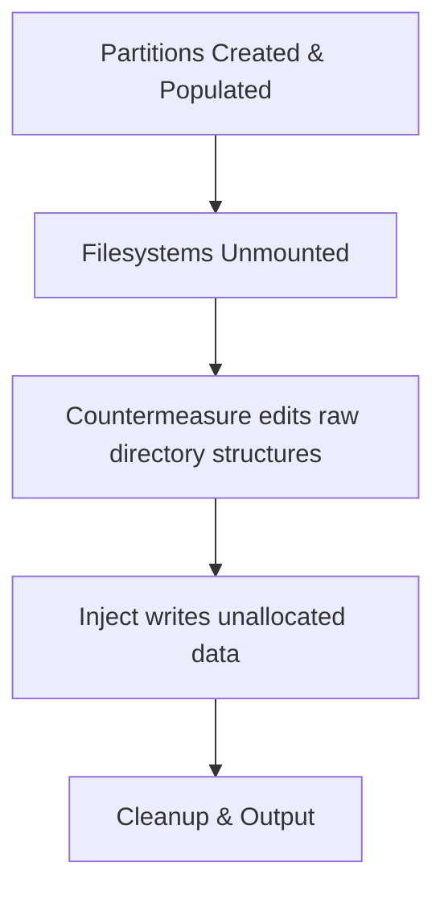

# Filesystem Countermeasures

Hide files in a directory by editing on-disk directory structures, the way an anti-forensics tool would. The files and their data stay on disk, but the operating system no longer lists them. Students have to find them with raw analysis (a hex editor, TSK, or carving directory entries).

| Type | Filesystems | What it changes |
|------|-------------|-----------------|
| `fat_dir_zero` | `fat32`, `exfat` | Moves the hidden entries to the end of the directory and sets the first byte of each one to `0x00`, the end-of-directory marker |
| `ntfs_index_flag` | `ntfs` | Sets the `LAST_ENTRY` flag (`0x02`) on the first hidden entry in the directory's `$I30` index |
| `ntfs_index_truncate` | `ntfs` | Inserts an end entry before the hidden entries and shrinks the index's bytes-in-use, pushing them into index slack |

---

## How It Works



Countermeasures run after every partition is populated and unmounted, and before [unallocated injection](injection.md).

### FAT32 and exFAT (`fat_dir_zero`)

A FAT directory is a list of 32-byte entries, and a first byte of `0x00` means "no more entries". DiskForge moves the hidden files' entries (including FAT32 long-filename entries and the full exFAT entry set) to the end of the directory, after the visible ones, and then zeroes the first byte of each hidden entry. Windows stops reading at the first zeroed entry. Linux skips each one as free. The rest of every entry, including the name, timestamps, starting cluster and size, is left intact, and so is the file data.

The order you list files in `hide` doesn't matter. Any entries in the directory can be hidden.

### NTFS (`ntfs_index_flag`, `ntfs_index_truncate`)

NTFS lists a directory by walking its `$I30` index until it reaches an entry flagged `LAST_ENTRY`.

- **`ntfs_index_flag`** marks the first hidden entry as the last one. The hidden entries stay inside the in-use part of the index. TSK's `fls` still lists them as allocated files.
- **`ntfs_index_truncate`** writes a new 16-byte end entry where the first hidden entry was, shifts the hidden entries after it, and reduces the index "bytes in use" so they fall into slack. `fls` reports them as deleted entries recovered from slack.

Pick one method per directory. Different directories on the same volume can use different methods.

!!! warning "NTFS index entries are sorted by name"
    An NTFS index is kept in name order, so these methods hide the cut entry and **everything that sorts after it**. Every file in `hide` must sort after every visible file in that directory. DiskForge checks this and stops the build if a visible file would be hidden too. Name hidden files so they sort last, for example `zz_secret.txt` or `~notes.txt`.

The MFT records, `$Bitmap` and file data are untouched, so the hidden files still show up as orphans when the MFT is analyzed.

---

## Configuration

Add a `countermeasure` object to a partition (or at the disk level for a [RAW disk](manifest-reference.md#raw-disk-superfloppy)):

```json
{
  "number": 1,
  "type": "primary",
  "filesystem": "ntfs",
  "label": "EVIDENCE",
  "size": "100M",
  "populate": {
    "add_files": [{ "source": "/files/*", "target": "/" }]
  },
  "countermeasure": {
    "type": "ntfs_index_flag",
    "path": "/Documents",
    "hide": ["zz_secret.txt"]
  }
}
```

| Field | Type | Required | Description |
|-------|------|----------|-------------|
| `type` | string | Yes | `fat_dir_zero`, `ntfs_index_flag`, or `ntfs_index_truncate` |
| `path` | string | No | Directory that holds the files to hide (default `"/"`) |
| `hide` | array | Yes | Names of files or folders inside `path` to hide |

### Several directories

To hide files in more than one directory, make `countermeasure` a list, with one entry per directory:

```json
"countermeasure": [
  { "type": "ntfs_index_truncate", "path": "/Users/jdoe/Documents", "hide": ["zz_ledger.xlsx"] },
  { "type": "ntfs_index_flag", "path": "/", "hide": ["~staging"] }
]
```

DiskForge applies the deepest directories first, so an entry can hide a folder that another entry's `path` goes through. The list order doesn't matter. Two entries for the same directory are rejected; put all of that directory's names in one `hide` list.

---

## Limitations

- On NTFS, the directory's index must be a single node: either small enough to sit inside the MFT record, or one INDX block. A few dozen files is fine; the build stops if the index has grown a second level.
- Countermeasures can't be combined with VeraCrypt full-disk encryption.
- Matching is case-insensitive on FAT32 and exFAT, and exact on NTFS.

---

## Verifying

The `example_countermeasures` example builds two disks, each with one partition per method: one hides files in the root directory, the other in `/images`. To check a result by hand:

```bash
# Hidden files are absent from a normal mount
mount -o ro /dev/mapper/loop0p3 /mnt && ls /mnt

# NTFS: TSK still finds them (allocated for index_flag, deleted for index_truncate)
fls /dev/mapper/loop0p3
```

For FAT32 and exFAT, open the directory's cluster in a hex editor. The hidden entries come after the visible ones, each starting with `00`.
